# Workspace Ribbon for QGIS

An ArcGIS Pro style workspace for QGIS 3.40+ and QGIS 4. It replaces the menu bar and toolbars with a
ribbon organised the way Pro users expect, adds Pro's contextual layer tabs, builds print-ready map
sheets in one click, and gives your own plugins proper tabs instead of an "everything else" pile.

> **A modified version of ArcSkin.** Workspace Ribbon is built on
> [ArcSkin](https://github.com/envirosolutionspl/arcskin) by
> [EnviroSolutions](https://github.com/envirosolutionspl)
> ([QGIS plugin page](https://plugins.qgis.org/plugins/arcskin/)), version 0.6.1, under the
> GNU GPL v2 or later. ArcSkin's light theme, icons, panes, map status bar, basemap gallery and
> symbology are used as they are; the ribbon was rewritten. See
> [What's changed from ArcSkin](#whats-changed-from-arcskin). ArcSkin is no longer updated by its
> authors; they continue it as CyanSkin in the QGIS plugin repository.

## Contents

- [The ribbon](#the-ribbon)
- [Contextual layer tabs](#contextual-layer-tabs)
- [Attributes pane](#attributes-pane)
- [Editing: Create and Modify Features](#editing-create-and-modify-features)
- [Explore and Locate](#explore-and-locate)
- [Attribute tables below the map](#attribute-tables-below-the-map)
- [Panes and docking](#panes-and-docking)
- [Making maps](#making-maps)
- [Layout ribbon](#layout-ribbon)
- [Esri-style edit sketch](#esri-style-edit-sketch)
- [Room to work](#room-to-work)
- [What's changed from ArcSkin](#whats-changed-from-arcskin)
- [Install](#install)
- [Notes](#notes)
- [Credits and licence](#credits-and-licence)

## The ribbon

| Tab | Groups |
| --- | --- |
| **Project** (blue) | New, Open, Save, recent projects, properties, options, and the full QGIS menu bar |
| **Map** | Clipboard · Navigate · Layer (Basemap, Add Data) · Selection · Inquiry · Labeling |
| **Insert** | Project (New Map, New Layout, Import Layout) · Layer Templates · Map Elements · Styles |
| **Layout** | Page Layout (New, Open, Import, Manager) · Map View · Export |
| **Analysis** | Geoprocessing (Tools, ModelBuilder, History, Python) · Vector, Raster, Database, Web and Mesh tools |
| **View** | Windows (Reset Panes and every pane) · Workspace (Maximize Map, Collapse Ribbon, Map Only, Full Screen) · 3D, Overview, Time |
| **Edit** | Clipboard · Manage Edits · Snapping · Features · Tools (Align Edge, Advanced Digitizing, Move … Reverse) · COGO · Modify · Shapes |
| **Imagery** | Add raster · Georeference, Raster Calculator, Align Rasters |
| **Share** | Export layouts and maps (PDF, image, DXF), Package Layers · Print |
| **Parcels** | [Parcel Fabric](https://github.com/pwizzle77-cmd/qgis_parcel_fabric): Fabric · Records · Parcel Tools · Legal & Analysis · Numbering & QA · Settings · COGO |
| **Addressing** | [NENA Addressing and RCL Tools](https://github.com/pwizzle77-cmd/qgis-nena-addressing-tools): Windows · Centerlines · Addressing · Setup |
| **Help** | Help · Plugins, Options, Customization |
| **Add-ins** | Only plugins the ribbon doesn't already place somewhere else |

The Parcels and Addressing tabs appear when those plugins are installed.
[Align Edge](https://github.com/pwizzle77-cmd/qgis-align-edge) and
[COGO Workbench](https://github.com/pwizzle77-cmd/qgis_cogo_workbench) go on the Edit tab, where Pro
users look for them.

**Edit** — editing tools, snapping, a Selection group (Select, Clear), Align Edge and COGO in one place:

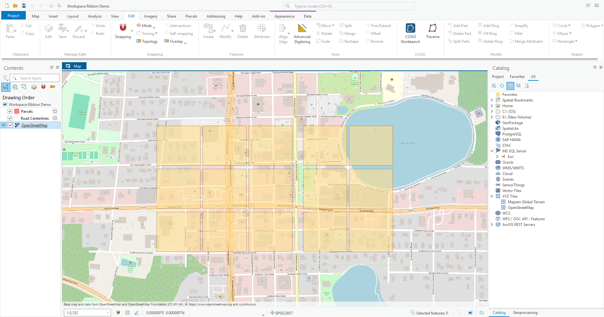

**Parcels** — the Parcel Fabric plugin as a tab:

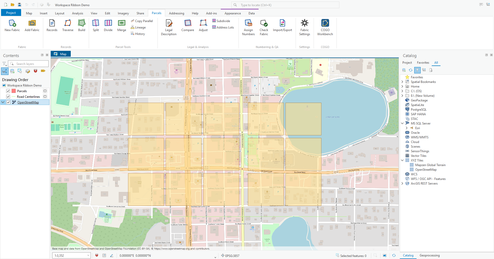

**Addressing** — NENA Addressing and RCL Tools as a tab:

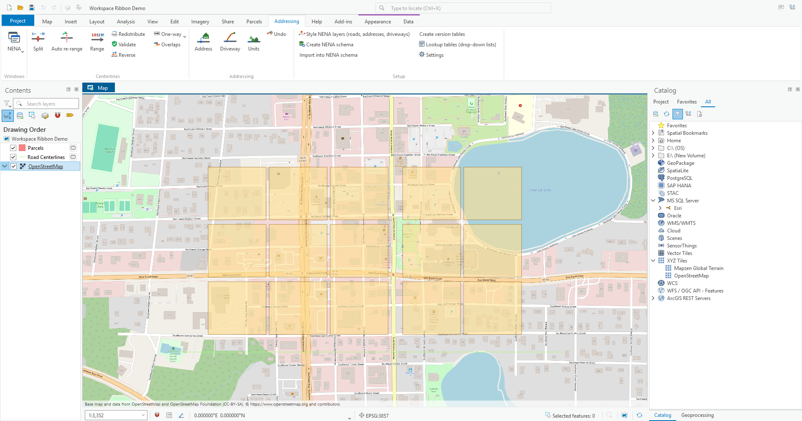

**Insert** and **View**:

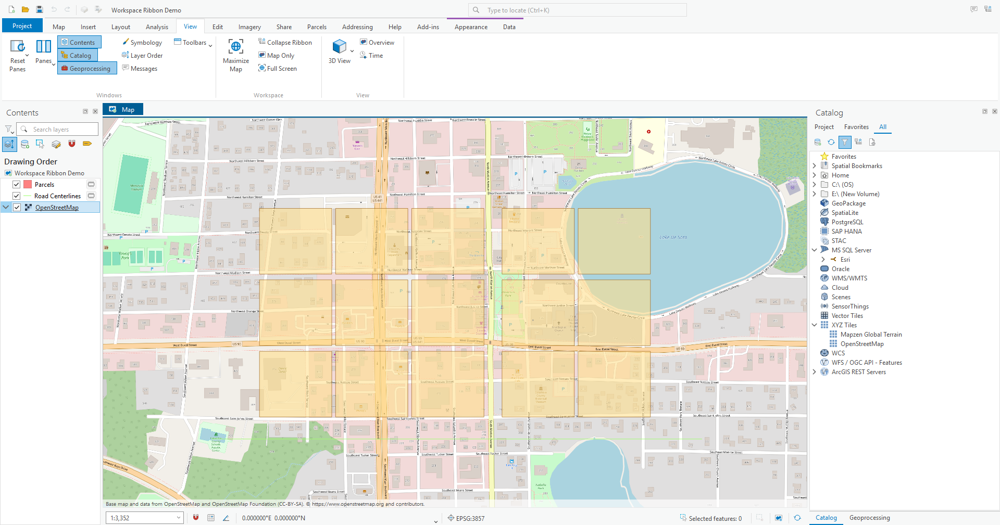

## Contextual layer tabs

Select a layer in Contents and Pro's contextual tabs appear at the end of the ribbon, marked with a
coloured band:

- **Feature Layer** (green): Appearance (Symbology, Visibility Range, Diagrams, Masking), Labeling
  (label on/off, label settings, move/rotate/show-hide labels), Data (Attribute Table, Calculate
  Field, Fields, Form, Definition Query, Joins, Relates, Export Features)
- **Raster Layer** (purple): Appearance, Data (Histogram, Export Raster)
- **Standalone Table** (orange): Data

As in Pro, these tabs change the layer right from the ribbon, without opening Layer Properties:

- **Appearance**: a **Transparency** slider; the **Visibility Range** (*Out Beyond* / *In Beyond*
  scales, with *Clear Limits*); and **Swipe**: drag across the map to peel the layer back and see
  what's under it (Shift+drag swipes up and down; Esc or another tool ends it).
- **Labeling**: the label **Field** (or an expression), **font, size, bold and colour**, and
  **Placement** (choices for points, lines or polygons). Changing any of them turns the labels on.
  Rule-based labels are left alone; edit those in Label Settings.

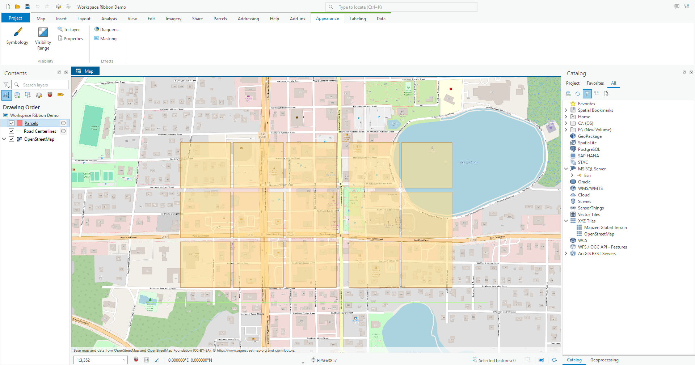

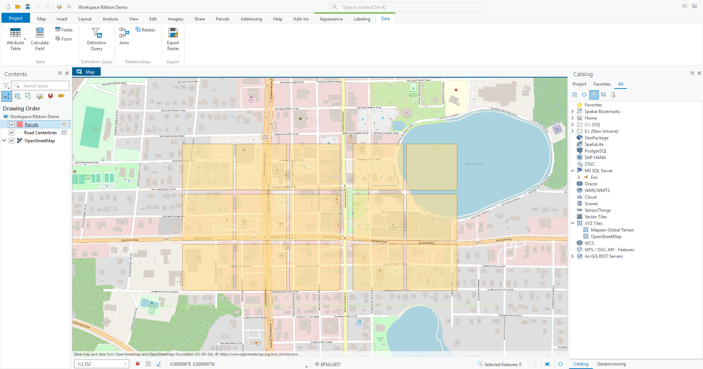

## Attributes pane

As in Pro, selecting features opens an **Attributes** pane (tabbed with the Catalog):

- The top half lists the selected features of every layer, grouped by layer and named by the layer's
  display expression. Click a feature to edit it; click the layer to change a field on **all** its
  selected features at once (then *apply changes*).
- The bottom half shows the feature's fields stacked vertically, using the layer's own attribute
  form, so value maps, lookup drop-downs, date pickers and constraints work as in the layer's form.
- **Auto Apply** (on by default): a click in the fields starts editing on that layer, and each change
  is written as you type. *Save Edits* still commits to the data source. Turn Auto Apply off to get an
  **Apply** button instead.
- The pane opens by itself after a selection with a **Select** tool or **Select By Attributes / Form**;
  while open it follows every selection. Open it any time from *Map › Selection › Attributes* or
  *Edit › Features › Attributes*.
- Buttons: Zoom to, Flash, Remove from selection, Open the attribute table (selected).

## Editing: Create and Modify Features

*Edit › Features › Create* opens the **Create Features** pane, as in Pro:

- One **feature template** per editable layer, and one per category for layers drawn with
  categorized symbology (a template for each road class, say), with the layer's own symbol. Type in
  the search box to filter.
- Click a template and the layer goes into edit mode, becomes the active layer and the tools for its
  geometry show below: Point; Line, Arc, Bézier, Freehand, Trace, Right Angle and the shapes
  (rectangle, circle, ellipse, regular polygon) for lines and polygons.
- **Template attributes**: give a template default values (e.g. Status = Active, Road Class = Local).
  New features get them for every field they leave empty. They're saved in the project.
- While a construction tool is active, a **sketch toolbar** floats at the bottom of the map: Line,
  Arc, Bézier, Freehand, Trace, Snapping, Advanced Digitizing (constraints), Undo vertex, **Finish
  (F2)** and Cancel. With the Vertex tool (Pro's Edit Vertices) it shows Snapping, Advanced
  Digitizing, Vertex Editor, Delete vertex, Undo, Finish (F2) and Cancel.
- **Selection chip**: click with the Select tool and the top-most feature is selected, on any
  selectable layer (not just the active one). Where several features overlap, a small chip with the
  number of features appears next to the cursor; click it for a list grouped by layer, hover an entry
  to highlight it on the map and click to select that feature instead. Shift/Ctrl clicks are left to
  QGIS.

*Edit › Features › Modify* opens the **Modify Features** pane: every editing tool in one searchable
list, grouped as in Pro (General, Alignment, Construct, Divide, Reshape, Attributes, COGO and
parcels), including Align Edge, the NENA Split & Re-range tool, the Parcel Fabric tools and COGO
Workbench when those plugins are installed. Pick a tool to start it; the box below says what it does
and how to use it.

## Explore and Locate

- **Explore** (*Map › Navigate*) works like Pro's: drag to pan, wheel to zoom, and **click a
  feature** for a **pop-up** of its fields (value maps and lookups shown as their labels). When
  several features are under the cursor, the pop-up lists them all. Its buttons zoom to, flash,
  select or open the feature in the Attributes pane. QGIS's plain Pan tool is in the drop-down.
- **Locate** (*Map › Inquiry*) is one search box for the county:
  - **coordinates**: latitude/longitude (decimal or DMS, latitude first, as Google Maps shows them),
    MGRS / US National Grid, UTM;
  - **addresses** (start with the house number: *123 main*): the NENA Addressing and RCL Tools
    address-point layer, or any point layer with an address field;
  - **streets** (*main st*): the NENA centerline layer, or any line layer with a full street name
    field (FULLNAME…), each street once, zooming to all its segments;
  - **parcels** (*12-4S-16-02942-000* or part of it): layers with a parcel-number field (ParcelNo,
    ParcelID, PIN…).

  Click a result to zoom to it; features flash and coordinates get a pin. When nothing matches, a
  button searches OpenStreetMap.

## Attribute tables below the map

With *View › Docking › Tables Below Map* on (the default), attribute tables open docked **under the
map as tabs**, newest in front, instead of as separate windows. A table's own Dock/Undock button still
floats it out.

## Panes and docking

- Every pane gets a Pro-style title bar with **▾** (pane menu), **Float/Dock** and **Close**.
- **Double-click** a pane's title to float it; double-click a floating pane's title to dock it back.
- **Right-click** a title (or ▾): *Dock Left*, *Dock Right*, *Float*, *Dock All Floating Panes*, *Close*.
- *View › Docking*: **Dock Floating Panes**, **Dock Left**, **Dock Right** (for the pane you last used).
- *View › Reset Panes* also docks floating panes back.
- Panes float one at a time. (QGIS normally lets a tab group be dragged out together; on Windows that
  group gets an ordinary window title bar that can't dock it back, which is how a pane gets stuck.)

## Making maps

**New Layout** (on the Insert and Layout tabs) opens a gallery of page sizes — Letter, Legal, Tabloid,
ANSI C, D and E, A4 and A3 — each landscape or portrait, as a **finished map sheet** or a blank page.
A map sheet has the map at your current extent, a title (the project title), a legend that lists only
what the map shows, a north arrow, a scale bar (feet/miles on ANSI sizes, metres/kilometres on ISO
sizes) and a footer with the date and coordinate system.

Your own `.qpt` layout templates appear under **My Templates**; any template can be imported.
**Open Layout** lists the project's layouts, and **Export Layout** writes one or all of them to PDF.

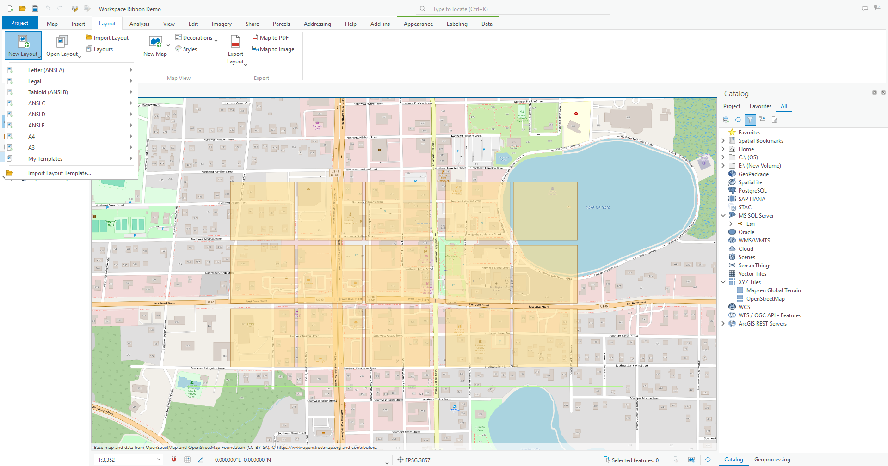

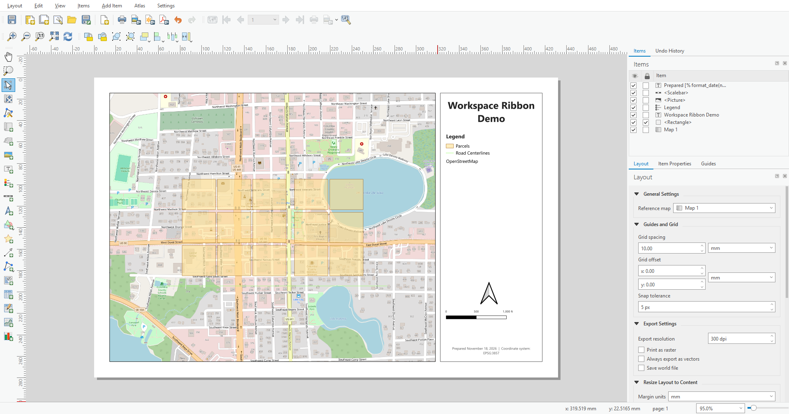

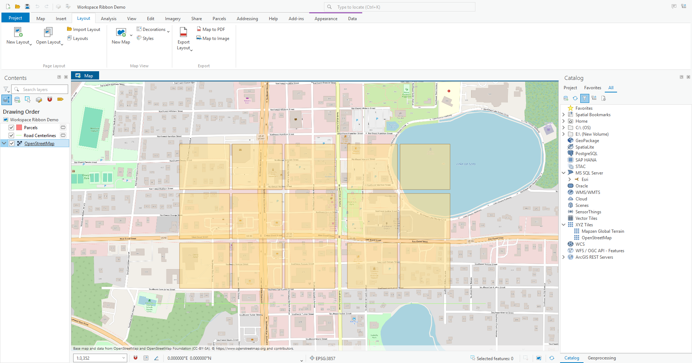

## Layout ribbon

A layout opened in the layout designer gets its own ribbon, in place of the designer's menus and
toolbars (the menus stay under the blue **Layout** button), with Pro's layout tabs:

- **Layout**: Clipboard, Navigate (Explore, Select, zooms, Move Content, Edit Vertices), Page Setup,
  Show (rulers, guides, grid, smart guides, bounding boxes), Undo/Redo
- **Insert**: Map Frame; Map Surrounds (Legend, North Arrow, Scale Bar, Table, Chart, Profile);
  Graphics and Text (Text and dynamic text, Picture, Rectangle/Ellipse/Triangle, Polygon, Line/Arrow,
  Marker, HTML)
- **Arrange**: Group, Order, Align, Distribute, Size, Lock
- **Map Series** (QGIS's atlas): settings, preview, page navigation, export
- **Share**: Export PDF / image / SVG, Print, save as a layout template, Layout Manager

The designer's toolbars come back when it closes, so QGIS still has them with the workspace off.

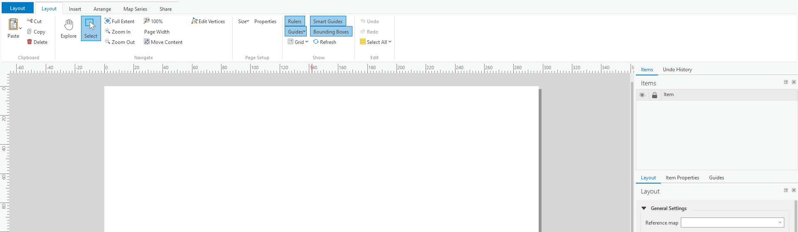

## Esri-style edit sketch

While you digitize, the sketch (QGIS's rubber band) is drawn like ArcGIS's edit sketch: a solid green
2 px line with a light green fill instead of QGIS's thin, faded red one, and existing vertices show as
small circles instead of crosses. Only settings still at QGIS's default are changed, so colours you
picked in *Settings › Options › Digitizing* stay; switching the workspace off restores QGIS's own.

## Room to work

- **Collapse the ribbon**: double-click any tab, press **Ctrl+F1**, or use the button at the right of
  the title row. Click a tab to open it for one use; a click in the map folds it away again.
- **View › Maximize Map** hides every docked pane; click again to bring them back.
- **View › Reset Panes** for Mapping, Editing or Geoprocessing, as in Pro.
- The Quick Access row has New, Open, Save, **Save All**, Undo, Redo, **Toggle Editing** and **Save Edits**.
- **Save All** (**Ctrl+Alt+S**) saves the edits of every layer you're editing (they stay in edit mode) and then the project, in one click. It's greyed out until there's something to save: unsaved layer edits or project changes. It's also on *Edit › Manage Edits* and in the *Project* menu.

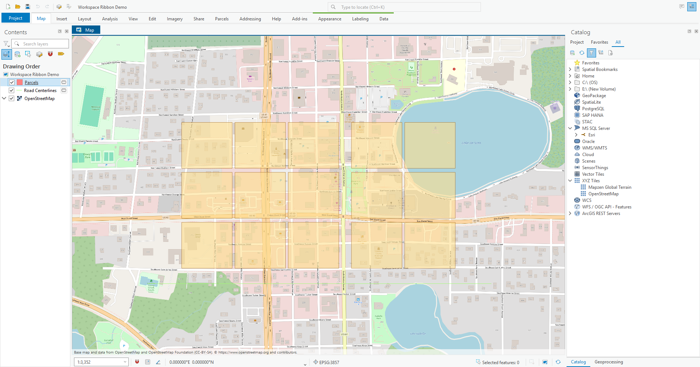

## What's changed from ArcSkin

Kept from [ArcSkin 0.6.1](https://github.com/envirosolutionspl/arcskin) unchanged: the light Pro-like
theme and its style sheet, the icon theme for all of QGIS and the Pro-style icons, the Contents /
Catalog / Geoprocessing / Symbology panes, map view tabs, the map status bar with typed coordinates,
the basemap gallery, the attribute table footer, default symbology and colour ramps, and switching
the look off to restore QGIS exactly.

Changed or added:

| Area | ArcSkin 0.6.1 | Workspace Ribbon |
| --- | --- | --- |
| Ribbon tabs | Map, Insert, Analysis, View, Edit, Share, Help, Add-ins | Map, Insert, **Layout**, Analysis, View, Edit, **Imagery**, Share, **Parcels**, **Addressing**, Help, Add-ins |
| Plugin toolbars | All on the Add-ins tab, one group per toolbar | Known plugins get their own tabs with named groups and short captions (Parcels, Addressing) or go on the Edit tab (Align Edge, COGO Workbench); Add-ins holds only the rest |
| Plugin buttons that are widgets | Left out | Copied, so drop-down buttons such as NENA's **NENA** and **One-way** menus work in the ribbon |
| Plugin toolbars re-shown by their plugin | Could appear above the ribbon | Kept hidden while the ribbon is on |
| Contextual tabs | None | Feature Layer, Raster Layer and Standalone Table tabs follow the layer selected in Contents |
| Layouts | New Layout and Layout Manager buttons | New Layout gallery with finished map sheets in ANSI and ISO sizes, My Templates, Import Template, Open Layout list, Export Layout (one or all to PDF) |
| Workspace | — | Collapsible ribbon (double-click, Ctrl+F1, peek on click), Maximize Map, Map Only, Full Screen |
| Quick Access row | New, Open, Save, Undo, Redo | Adds Save All (Ctrl+Alt+S: every layer's edits and the project), Toggle Editing and Save Edits, and the collapse button |
| Edit tab | Tools and Modify groups | Tools (with Align Edge and Advanced Digitizing), a COGO group, a Selection group (Select, Clear), Attributes in Features, as in Pro |
| Selection / Labeling | Basic | Pro captions (Select By Attributes / Location, Switch), label Show/Hide, Rotate and Properties |
| Share tab | Image, PDF, DXF, Layout | Adds Export Layout and Package Layers |
| Attributes pane | — | Pro-style Attributes pane for the selection: feature list, vertical fields in the layer's form, multi-edit, Auto Apply |
| Pane title bars | Qt / Windows title bars | Pro-style title bar on every pane (▾ menu, Float/Dock, Close); double-click docks a floating pane; Dock Left / Right / All Floating; panes float one at a time |
| Edit sketch | QGIS default (thin red rubber band) | Esri-style green sketch line and fill, circle vertex markers (QGIS defaults only; restored when switched off) |
| Rebuild | Switch off and on | **Plugins › Workspace Ribbon › Rebuild Ribbon** picks up plugins enabled after start-up |
| ArcSkin | — | Switching Workspace Ribbon on turns ArcSkin's look off (both at once would fight over the window) |
| Settings | `arcskin/…` keys, `ArcSkin` icon theme | Its own `workspace_ribbon/…` keys and `WorkspaceRibbon` icon theme, so the two plugins don't overwrite each other |
| Translations | English, Polish | English only (for now) |

The changed code is in `ribbon.py` (rewritten), `layouts.py` and `attributes_pane.py` (new), `panes.py` (docking), `plugin.py`, `__init__.py` and
`metadata.txt`; small renames of settings keys and markers in `icon_theme.py`, `stylesheet.py`,
`panes.py`, `dialogs.py`, `mapview.py`, `basemaps.py` and the theme's `style.qss`.

## Install

**From a zip:** download the release zip, then in QGIS go to *Plugins › Manage and Install Plugins ›
Install from ZIP*. The plugin is marked experimental: if it isn't listed, tick *Show also experimental
plugins* in the Settings tab.

**From source:** copy this repository into your QGIS profile's `python/plugins` folder as
`workspace_ribbon` (on Windows, `%APPDATA%\QGIS\QGIS4\profiles\default\python\plugins`, or `QGIS3` for
QGIS 3) and enable it in the Plugin Manager.

Switch it on or off from *Plugins › Workspace Ribbon › Workspace Ribbon* or *Project › Workspace Ribbon*.

## Notes

- Disable ArcSkin (or CyanSkin) in the Plugin Manager when you use Workspace Ribbon.
- A ribbon button whose QGIS tool doesn't exist in your QGIS version is left out rather than shown
  broken.
- The screenshots were taken with [`scripts/capture_screenshots.py`](scripts/capture_screenshots.py),
  run from the QGIS Python console on demo data over OpenStreetMap.

## Credits and licence

- [ArcSkin](https://github.com/envirosolutionspl/arcskin) by [EnviroSolutions](https://github.com/envirosolutionspl),
  GPL-2.0-or-later: theme, icons, panes, status bar, basemaps, symbology and the original ribbon.
- Workspace Ribbon changes by Charles, GPL-2.0-or-later. See [LICENSE](LICENSE).
- Basemap in the screenshots © [OpenStreetMap](https://www.openstreetmap.org/copyright) contributors.

Not affiliated with or endorsed by Esri. ArcGIS and ArcGIS Pro are trademarks of Esri.
